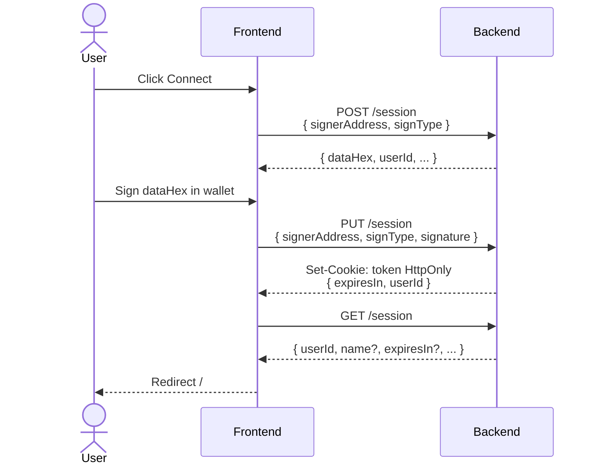

# Login Flow (Frontend & Backend)

---

| Field              | Detail                                                                                                  |
|--------------------|---------------------------------------------------------------------------------------------------------|
| **Document Title** | Login Flow (Frontend & Backend)                                                                         |
| **Version**        | 0.1.4                                                                                                   |
| **Created**        | February 3, 2026                                                                                        |
| **Last Revised**   | July 23, 2026                                                                                       |
| **Companion Doc**  | [System Architecture Specification](system-architecture.md) · [API Specification](api-specification.md) |
| **Prepared By**    | Adam Dean · <adam@crypto2099.io>, Mad Orkestra · <mad@madorkestra.com>                                  |
| **Status**         | Draft                                                                                                   |

---

This document describes how authentication works end-to-end: wallet-based
sign-in (nonce and signature), session and JWT handling, and how the frontend
and backend stay in sync.

## Overview

Authentication is **wallet-based**: the user proves ownership of a Cardano
address (stake or DRep) by signing a nonce challenge. No passwords are stored.
The backend issues a JWT after verifying the signature and sets it only as an
httpOnly `token` cookie. The frontend never stores the JWT in JavaScript-readable
storage; later requests send the cookie via `credentials: 'include'`.

- **Backend**:
    - Express under `/api/v0`
        - session routes in `routes/api/v0/session.js`
        - token verification in `helper/verifyToken.js` and
          `helper/middleWare.js`.
- **Frontend**:
    - SvelteKit app
        - session state in `__frontend/src/stores/sessionManager.js`
        - login UI in `__frontend/src/lib/WalletSigner/`.

---

## Backend Login Flow

### 1. Request a nonce — `POST /api/v0/session`

**Purpose:** Get a one-time challenge string that the user must sign with their
wallet.

**Request body:**

| Field           | Type   | Required | Description                           |
|-----------------|--------|----------|---------------------------------------|
| `signerAddress` | string | Yes      | Bech32 address (stake or DRep) or hex |
| `signType`      | string | Yes      | `'drep'` or `'stake'`                 |

**Middleware:** `validateSessionRequest` (validates address and `signType`),
`nonceRequestLimiter` (five requests/min per IP).

**Backend behavior:**

1. Generates nonce with Mesh `generateNonce("Sign in! ")`.
2. Persists a `Session` document with `userId` (Bech32) and `nonce`.
3. Returns `dataHex` (nonce to sign), `userId`, `userIdHex`, `signerAddressHex`.

**Response (200):** `{ dataHex, userId, userIdHex, signerAddressHex }`

Nonce are single-use, expire after five minutes, and are rate-limited. Session
documents are cleaned up by a TTL index (e.g., one hour) and by explicit cleanup
after successful login.

### 2. Verify signature and issue JWT — `PUT /api/v0/session`

**Purpose:** Verify that the user signed the nonce, then issue a JWT and set the
auth cookie.

**Request body:**

| Field           | Type   | Required | Description                   |
|-----------------|--------|----------|-------------------------------|
| `signerAddress` | string | Yes      | Same as in POST               |
| `signType`      | string | Yes      | Same as in POST               |
| `signature`     | object | Yes      | Wallet signature of `dataHex` |

**Middleware:** `validateSessionRequest`, `sessionVerificationLimiter` (ten
attempts/min per IP).

**Backend behavior:**

1. Finds the most recent non-expired, non-null nonce for `userId` and atomically
   sets `nonce` to `null` (single-use).
2. Verifies the signature via
   `verifySignature(nonce, signerAddress, signature)`.
3. Builds a JWT with `{ userId, signType, sv }`, signed with `JWT_SECRET`,
   expiry from `JWT_MAX_AGE` (e.g. `1d`). `sv` is the user's current
   `sessionVersion` (default `0`).
4. Sets HTTP-only cookie `token` (same options as in `routes/api/v0/session.js`:
   path `/`, secure in production, sameSite strict/lax).
5. Optionally fetches display name (DRep registry or handle service) and upserts
   `User` with `name` and `lastLogin`.
6. Cleans up other nonces for the user and old session documents.

**Response (200):** `{ expiresIn, userId }` (and `Set-Cookie: token=...` httpOnly). The JWT is not returned in the JSON body.

### 3. Validate session / get current user — `GET /api/v0/session`

**Purpose:** Check if the request is authenticated and return user id and
profile data.

**Auth:** Required. Uses `isAuthenticated` middleware, which calls
`verifyToken(req)`.

**Token source:** Backend reads the JWT from the **httpOnly cookie** only:
`req.cookies?.token` (see `helper/verifyToken.js`). Bearer `Authorization`
headers are not accepted. The server uses `cookie-parser` and CORS with
`credentials: true` so the cookie set by `PUT /session` is sent on same-origin
or configured cross-origin requests to the API.

**Backend behavior:**

1. `verifyToken(req)` validates `req.cookies.token`: signature, expiry,
   presence of `userId`, and that claim `sv` is a number matching
   `User.sessionVersion` for that `userId`. Tokens without `sv` or with a
   mismatched version are rejected (401).
2. On success, `req.userId`, `req.signType`, and `req.exp` are set; handler loads
   `User` name and votes where the user is admin.
3. Returns `{ userId, name?, expiresIn?, adminVoteIds? }`.

**Response (200):** `{ userId, name?, expiresIn?, adminVoteIds? }`  
**Response (401):** Missing or invalid token (handled by `isAuthenticated`).

### 4. Logout — `DELETE /api/v0/session`

**Purpose:** Invalidate the session by clearing the auth cookie and bumping
server-side session version.

**Auth:** Required (`isAuthenticated`).

**Backend behavior:** Increments `User.sessionVersion` for the authenticated
user (so existing JWTs with the previous `sv` fail `verifyToken`), then clears
the httpOnly `token` cookie with the same path/secure/sameSite options used when
setting it. Returns success. Pre-deploy JWTs issued without an `sv` claim also
fail verification and require a one-time re-login.

---

## Frontend Login Flow

### Session state (`sessionManager.js`)

- **Stores:** `loggedIn` (boolean), `user` (object or null), `sessionExpiresAt`
  (ms timestamp or null). The JWT itself is never held in JS-readable storage.
- **Expiry:** `setSessionExpiry(expiresIn)` records expiry from login or
  `GET /session` for the session-expiry banner.
- **API helper:** `api.fetch(fetch, url, options)`:
    - Sends `credentials: 'include'` so the browser sends the httpOnly cookie.
    - Does not set `Authorization`.
    - On 401 when `loggedIn` was true, calls `expireSession()` and throws.

### Layout and session hydration

- **Root layout** (`__frontend/src/routes/+layout.js`): Runs in the client
  (`csr = true`). Probes `GET ${API_URL}/session` with `credentials: 'include'`.
  On 200, sets `user`, `loggedIn`, and `sessionExpiresAt` from `expiresIn`;
  otherwise clears login state. This restores session state on reload without
  reading the JWT in JavaScript.
- **Private layout** (`__frontend/src/routes/(private)/+layout.js`): In `load`,
  fetches `GET ${API_URL}/session` with `credentials: 'include'`. If the
  response is not ok or `sessionData.userId` is missing, redirects to `/`.
  Otherwise, passes `user: sessionData` to children. So all routes under
  `(private)` (e.g., dashboard) require a valid session cookie.

### Initiating login (Connect Wallet)

1. User clicks “Connect Wallet” (e.g., in `Header.svelte`), which opens
   `WalletSigner` in login mode.
2. User picks wallet and sign type (DRep, stake) and connects;
   `SignerWallet.svelte` (or `SignerCS.svelte`) runs the flow.
3. **Get nonce:** Frontend calls
   `getPayload("/session", connectedWallet.address, signType, scriptAddress)`,
   which does `POST /api/v0/session` with `{ signerAddress, signType }` (and
   optional `scriptAddress`). The nonce endpoint does not require auth.
4. **Sign:** Frontend uses `signData(connectedWallet, signer, payload.dataHex)`
   to have the wallet sign the nonce string.
5. **Submit:** Frontend calls
   `submitSignature("/session", payload.userId, signType, signature, payload.merkleRoot, scriptAddress)`,
   which sends `PUT /api/v0/session` with
   `{ signerAddress, signature, signType, data, scriptAddress }`.
6. **Backend** verifies signature, issues JWT, sets httpOnly `token` cookie and
   returns `{ expiresIn, userId }` (no JWT in body).
7. **Frontend** (`WalletSigner.svelte`): On success, `storeToken` runs:
    - `setSessionExpiry(expiresIn)` — expiry only; JWT stays httpOnly.
    - `loggedIn.set(true)`.
    - Fetches user data with `api.fetch(fetch, "/session/")` and sets
      `user.set(userData)`.
    - Redirects (callback path, `/dashboard` from `/login`, or `invalidateAll`).

So the **frontend login sequence** is: POST `/session` → sign nonce in wallet →
PUT `/session` → set expiry and user from cookie session, then redirect.

### Logout

- **Frontend:** `logout()` in `sessionManager.js`:
    1. Calls `DELETE /api/v0/session` with `credentials: 'include'`.
    2. Clears legacy JS-readable token leftovers, sets `loggedIn` / `user` /
       `sessionExpiresAt` to null, then `goto("/")`.

---

## Sequence Summary

---

## Protected Routes and Token Usage

- **Backend:** Any route that needs the current user uses `isAuthenticated`. It
  reads the JWT from `req.cookies.token` via `verifyToken(req)` and attaches
  `req.userId`, `req.signType`, and `req.exp`. The frontend sends the token only
  via the httpOnly cookie (`credentials: 'include'`).
- **Frontend:** For authenticated API calls, use
  `api.fetch(fetch, url, options)` so cookies are included and 401 triggers
  session expiry handling. Private pages live under `(private)` and rely on the
  private layout’s session check and redirect.

---

## Environment and Security Notes

- **Backend:** `JWT_SECRET` is required; `JWT_MAX_AGE` (e.g. `1d`) controls
  token lifetime. CORS is configured with `credentials: true` and an allowed
  origin (e.g. `FRONTEND_URL`). Login JWTs include `sv` (`User.sessionVersion`);
  logout increments that version so prior tokens are rejected.
- **Frontend:** `VITE_API_URL` is the API base (e.g. `/api/v0` or full URL).
  Session auth relies on the server-set httpOnly cookie only.
- Nonce are stored in MongoDB (`Session`), single-use and short-lived; sessions
  are cleaned up by TTL and after successful login.

### Multisig (script) addresses

When the client includes `scriptAddress` on `POST /session` and `PUT /session`,
the script address is the session identity (`userId`); the connected wallet key
is only the signer.

1. **Nonce** — Bound to `scriptAddress` (not the payment/stake key alone).
2. **Verify** — Backend calls `isPartyToScript()`: the signature must be valid
   and the signing key hash must appear in the native script’s key list
   (**membership only**). The server does **not** require satisfying the full
   native script (e.g. `atLeast N`, `all`, or timelock windows) to issue a JWT.
3. **JWT** — `userId` is the script address; subsequent proposal/comment actions
   run as that identity.

This is intentional for the Proposal Module (off-chain proposals and comments do
not require on-chain multisig quorum). See
[system-architecture.md §8.1](system-architecture.md#81-accepted-risks) (F-002).

---

## Related Files

| Layer    | File(s)                                                                                                                                                                                                                      |
|----------|------------------------------------------------------------------------------------------------------------------------------------------------------------------------------------------------------------------------------|
| Backend  | `routes/api/v0/session.js`, `helper/verifyToken.js`, `helper/middleWare.js`, `schema/Session.js`                                                                                                                             |
| Frontend | `__frontend/src/stores/sessionManager.js`, `__frontend/src/lib/WalletSigner/WalletSigner.svelte`, `SignerWallet.svelte`, `WalletSigner.js`, `__frontend/src/routes/+layout.js`, `__frontend/src/routes/(private)/+layout.js` |
| API spec | `docs/api-specification.md` (Session section)                                                                                                                                                                                |

---

## Revision History

This document follows [Semantic Versioning 2.0.0](https://semver.org/). Version
numbers use the form **MAJOR.MINOR.PATCH**:

- **MAJOR** — Incompatible flow or contract changes (e.g. different auth
  mechanism, removed steps).
- **MINOR** — Backwards-compatible additions (e.g. new steps, new endpoints, new
  options).
- **PATCH** — Backwards-compatible fixes and clarifications (e.g. typo
  corrections, updated file paths).

| Version | Date       | Description                                         |
|---------|------------|-----------------------------------------------------|
| 0.1.4   | 2026-07-23 | Document `sessionVersion` / JWT `sv` and logout invalidation (F-023); clarify httpOnly-only JWT. |
| 0.1.3   | 2026-07-17 | Document multisig membership-only session semantics (F-002). |
| 0.1.2   | 2026-02-20 | Update to rename "Budget" to "Vote"                 |
| 0.1.1   | 2026-02-19 | Grammar and formatting updates.                     |
| 0.1.0   | 2026-02-18 | Document metadata block and Revision history added. |
