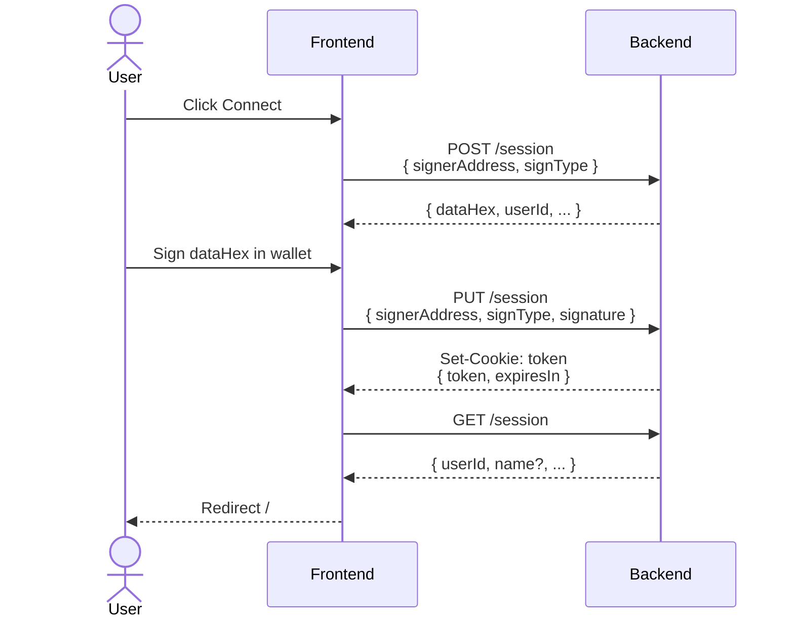

# Login Flow (Frontend & Backend)

---

| Field              | Detail                                                                 |
|--------------------|------------------------------------------------------------------------|
| **Document Title** | Login Flow (Frontend & Backend)                                        |
| **Version**        | 0.1.1                                                                  |
| **Created**        | February 3, 2026                                                       |
| **Last Revised**   | February 19, 2026                                                      |
| **Companion Doc**  | Ekklesia Integration Plan · [API Specification](api-specification.md)  |
| **Prepared By**    | Adam Dean · <adam@crypto2099.io>, Mad Orkestra · <mad@madorkestra.com> |
| **Status**         | Draft                                                                  |

---

This document describes how authentication works end-to-end: wallet-based
sign-in (nonce and signature), session and JWT handling, and how the frontend
and backend stay in sync.

## Overview

Authentication is **wallet-based**: the user proves ownership of a Cardano
address (stake or DRep) by signing a nonce challenge. No passwords are stored.
The backend issues a JWT after verifying the signature; the frontend stores the
JWT and sends it (or relies on the cookie set by the API) on later requests.

- **Backend**:
    - Express under `/api/v0`
        - session routes in `routes/api/v0/session.js`
        - token verification in `helper/verifyToken.js` and
          `helper/middleWare.js`.
- **Frontend**:
    - SvelteKit app
        - session state in `__frontend/src/stores/sessionManager.js`
        - login UI in `__frontend/src/lib/WalletSigner/`.

---

## Backend Login Flow

### 1. Request a nonce — `POST /api/v0/session`

**Purpose:** Get a one-time challenge string that the user must sign with their
wallet.

**Request body:**

| Field           | Type   | Required | Description                           |
|-----------------|--------|----------|---------------------------------------|
| `signerAddress` | string | Yes      | Bech32 address (stake or DRep) or hex |
| `signType`      | string | Yes      | `'drep'` or `'stake'`                 |

**Middleware:** `validateSessionRequest` (validates address and `signType`),
`nonceRequestLimiter` (five requests/min per IP).

**Backend behavior:**

1. Generates nonce with Mesh `generateNonce("Sign in! ")`.
2. Persists a `Session` document with `userId` (Bech32) and `nonce`.
3. Returns `dataHex` (nonce to sign), `userId`, `userIdHex`, `signerAddressHex`.

**Response (200):** `{ dataHex, userId, userIdHex, signerAddressHex }`

Nonces are single-use, expire after five minutes, and are rate-limited. Session
documents are cleaned up by a TTL index (e.g., one hour) and by explicit cleanup
after successful login.

### 2. Verify signature and issue JWT — `PUT /api/v0/session`

**Purpose:** Verify that the user signed the nonce, then issue a JWT and set the
auth cookie.

**Request body:**

| Field           | Type   | Required | Description                   |
|-----------------|--------|----------|-------------------------------|
| `signerAddress` | string | Yes      | Same as in POST               |
| `signType`      | string | Yes      | Same as in POST               |
| `signature`     | object | Yes      | Wallet signature of `dataHex` |

**Middleware:** `validateSessionRequest`, `sessionVerificationLimiter` (ten
attempts/min per IP).

**Backend behavior:**

1. Finds the most recent non-expired, non-null nonce for `userId` and atomically
   sets `nonce` to `null` (single-use).
2. Verifies the signature via
   `verifySignature(nonce, signerAddress, signature)`.
3. Builds a JWT with `{ userId, signType }`, signed with `JWT_SECRET`, expiry
   from `JWT_MAX_AGE` (e.g. `1d`).
4. Sets HTTP-only cookie `token` (same options as in `routes/api/v0/session.js`:
   path `/`, secure in production, sameSite strict/lax).
5. Optionally fetches display name (DRep registry or handle service) and upserts
   `User` with `name` and `lastLogin`.
6. Cleans up other nonces for the user and old session documents.

**Response (200):** `{ token, expiresIn }` (and `Set-Cookie: token=...`).

### 3. Validate session / get current user — `GET /api/v0/session`

**Purpose:** Check if the request is authenticated and return user id and
profile data.

**Auth:** Required. Uses `isAuthenticated` middleware, which calls
`verifyToken(req)`.

**Token source:** Backend reads the JWT from **cookies** only:
`req.cookies?.token` (see `helper/verifyToken.js`). The server uses
`cookie-parser` and CORS with `credentials: true` so the cookie set by
`PUT /session` is sent on same-origin or configured cross-origin requests to the
API.

**Backend behavior:**

1. `verifyToken(req)` validates `req.cookies.token`: signature, expiry, and
   presence of `userId`.
2. On success, `req.userId` and `req.signType` are set; handler loads `User`
   name and budgets where the user is admin.
3. Returns `{ userId, name?, adminBudgetIds? }`.

**Response (200):** `{ userId, name?, adminBudgetIds? }`  
**Response (401):** Missing or invalid token (handled by `isAuthenticated`).

### 4. Logout — `DELETE /api/v0/session`

**Purpose:** Invalidate the session by clearing the auth cookie.

**Auth:** Required (`isAuthenticated`).

**Backend behavior:** Clears the `token` cookie with the same
path/secure/sameSite options used when setting it. Returns success. No
server-side session store is updated; the JWT remains valid until expiry if
someone else had stored it, so client-side token clearing is important.

---

## Frontend Login Flow

### Session state (`sessionManager.js`)

- **Stores:** `loggedIn` (boolean), `user` (object or null), `jwt` (token string
  or null).
- **Token storage:** `setJWT(token, expiresIn)` writes the token to:
    - A cookie (via `js-cookie`) with path `/`, secure/sameSite by environment.
    - `localStorage` as fallback.
    - The `jwt` Svelte store.
- **Token read:** `getJWT()` returns token from cookie or localStorage and
  updates the `jwt` store.
- **API helper:** `api.fetch(fetch, url, options)`:
    - Uses `get(jwt) || getJWT()` and sets `Authorization: Bearer <token>` when
      present.
    - Sends `credentials: 'include'` so the browser also sends the cookie set by
      the API (if same-origin or allowed origin).
    - On 401, calls `logout()` and throws (e.g., redirect to log in / home).

### Layout and session hydration

- **Root layout** (`__frontend/src/routes/+layout.js`): Runs in the client
  (`csr = true`). If `getJWT()` returns a token, it calls
  `api.fetch(fetch, '/session/')`. On 200, it sets `user` and `loggedIn`;
  otherwise it sets `loggedIn = false`. This restores the session state on
  reload/navigation.
- **Private layout** (`__frontend/src/routes/(private)/+layout.js`): In `load`,
  fetches `GET ${API_URL}/session` with `credentials: 'include'`. If the
  response is not ok or `sessionData.userId` is missing, redirects to `/`.
  Otherwise, passes `user: sessionData` to children. So all routes under
  `(private)` (e.g., dashboard) require a valid session cookie.

### Initiating login (Connect Wallet)

1. User clicks “Connect Wallet” (e.g., in `Header.svelte`), which opens
   `WalletSigner` in login mode.
2. User picks wallet and sign type (DRep, stake) and connects;
   `SignerWallet.svelte` (or `SignerCS.svelte`) runs the flow.
3. **Get nonce:** Frontend calls
   `getPayload("/session", connectedWallet.address, signType, scriptAddress)`,
   which does `POST /api/v0/session` with `{ signerAddress, signType }` (and
   optional `scriptAddress`). The request uses `api.fetch`, so any existing
   token is sent; the nonce endpoint does not require auth.
4. **Sign:** Frontend uses `signData(connectedWallet, signer, payload.dataHex)`
   to have the wallet sign the nonce string.
5. **Submit:** Frontend calls
   `submitSignature("/session", payload.userId, signType, signature, payload.merkleRoot, scriptAddress)`,
   which sends `PUT /api/v0/session` with
   `{ signerAddress, signature, signType, data, scriptAddress }`.
6. **Backend** verifies signature, issues JWT, sets `token` cookie and returns
   `{ token, expiresIn }`.
7. **Frontend** (`WalletSigner.svelte`): On success, `storeToken` runs:
    - `setJWT(token, expiresIn)` — stores token in cookie, localStorage, and
      `jwt` store.
    - `loggedIn.set(true)`.
    - Fetches user data with `api.fetch(fetch, "/dashboard/")` and sets
      `user.set(userData)`. (Note: the backend does not define
      `/api/v0/dashboard`; the canonical endpoint for “current user” is
      `GET /api/v0/session`. If using a single backend, this call may need to
      target `/session/` or a proxy that maps `/dashboard` to session.)
    - `goto("/")`, closes the dialog.

So the **frontend login sequence** is: POST `/session` → sign nonce in wallet →
PUT `/session` → store token and user, then redirect.

### Logout

- **Frontend:** `logout()` in `sessionManager.js`:
    1. Calls `DELETE /api/v0/session` with `Authorization: Bearer <token>` (and
       `credentials: 'include'`).
    2. Clears the token cookie (same path/secure/sameSite as set) and
       `localStorage`, sets `jwt`, `loggedIn`, and `user` to null, then
       `goto("/")`.

---

## Sequence Summary

---

## Protected Routes and Token Usage

- **Backend:** Any route that needs the current user uses `isAuthenticated`. It
  reads the JWT from `req.cookies.token` via `verifyToken(req)` and attaches
  `req.userId` and `req.signType`. The frontend sends the token in the cookie
  (when calling the same API origin with `credentials: 'include'`) and
  optionally in `Authorization: Bearer`; the backend currently uses only the
  cookie for verification.
- **Frontend:** For authenticated API calls, use
  `api.fetch(fetch, url, options)` so the token is added and 401 triggers
  logout. Private pages live under `(private)` and rely on the private layout’s
  session check and redirect.

---

## Environment and Security Notes

- **Backend:** `JWT_SECRET` is required; `JWT_MAX_AGE` (e.g. `1d`) controls
  token lifetime. CORS is configured with `credentials: true` and an allowed
  origin (e.g. `FRONTEND_URL`).
- **Frontend:** `VITE_API_URL` is the API base (e.g. `/api/v0` or full URL).
  Cookie and `localStorage` use is environment-aware (secure, sameSite).
- Nonces are stored in MongoDB (`Session`), single-use and short-lived; sessions
  are cleaned up by TTL and after successful login. Script/multisig addresses
  use a separate multisig flow (not detailed here).

---

## Related Files

| Layer    | File(s)                                                                                                                                                                                                                      |
|----------|------------------------------------------------------------------------------------------------------------------------------------------------------------------------------------------------------------------------------|
| Backend  | `routes/api/v0/session.js`, `helper/verifyToken.js`, `helper/middleWare.js`, `schema/Session.js`                                                                                                                             |
| Frontend | `__frontend/src/stores/sessionManager.js`, `__frontend/src/lib/WalletSigner/WalletSigner.svelte`, `SignerWallet.svelte`, `WalletSigner.js`, `__frontend/src/routes/+layout.js`, `__frontend/src/routes/(private)/+layout.js` |
| API spec | `docs/api-specification.md` (Session section)                                                                                                                                                                                |

---

## Revision History

This document follows [Semantic Versioning 2.0.0](https://semver.org/). Version
numbers use the form **MAJOR.MINOR.PATCH**:

- **MAJOR** — Incompatible flow or contract changes (e.g. different auth
  mechanism, removed steps).
- **MINOR** — Backwards-compatible additions (e.g. new steps, new endpoints, new
  options).
- **PATCH** — Backwards-compatible fixes and clarifications (e.g. typo
  corrections, updated file paths).

| Version | Date       | Description                                         |
|---------|------------|-----------------------------------------------------|
| 0.1.1   | 2026-02-19 | Grammar and formatting updates.                     |
| 0.1.0   | 2026-02-18 | Document metadata block and Revision history added. |
