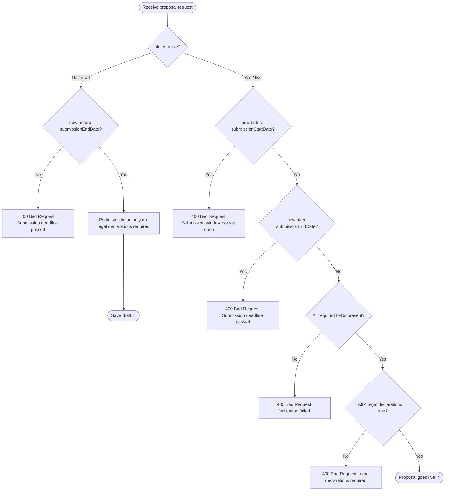
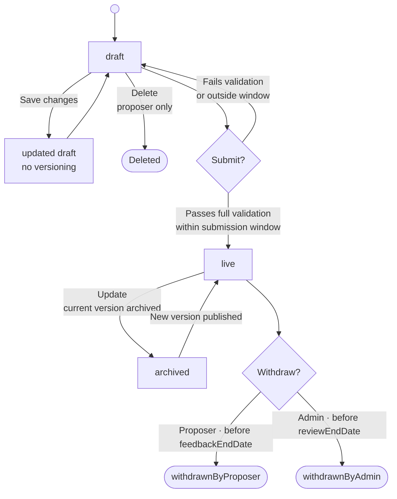
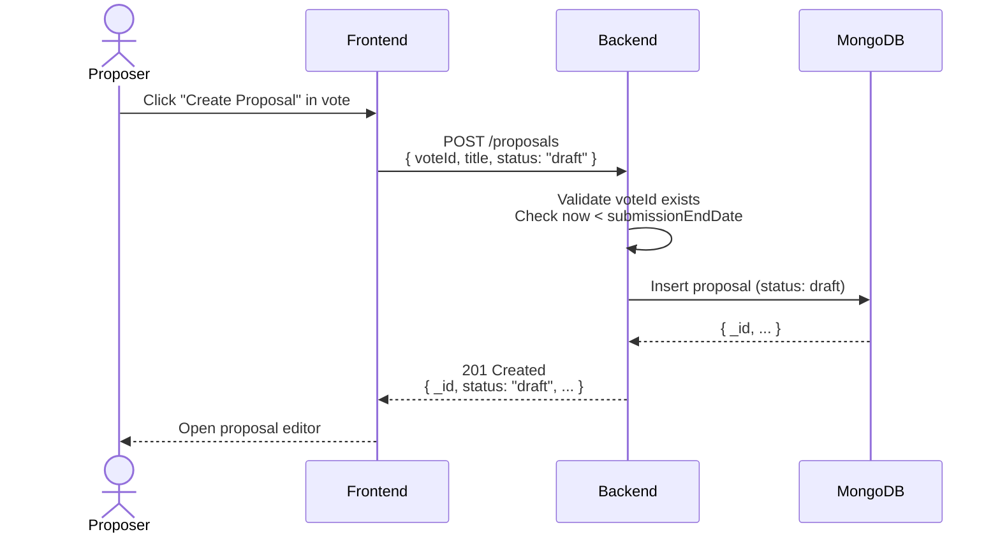
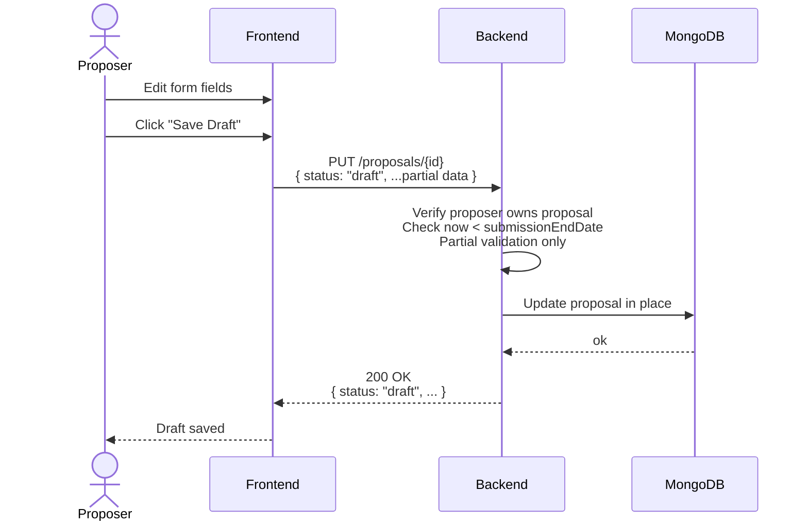
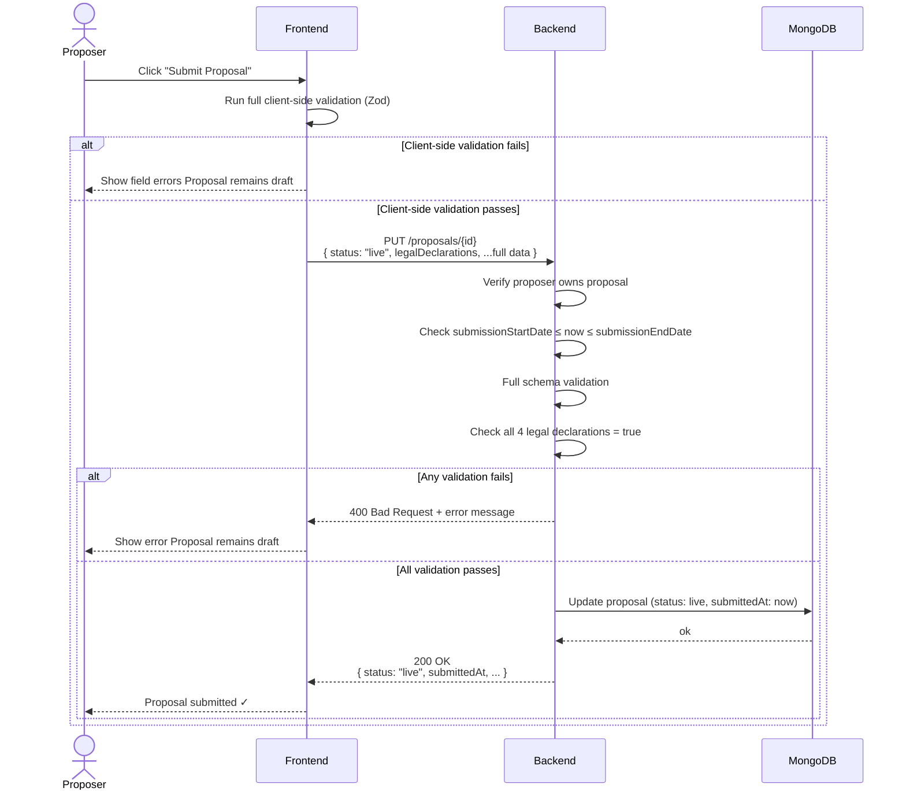
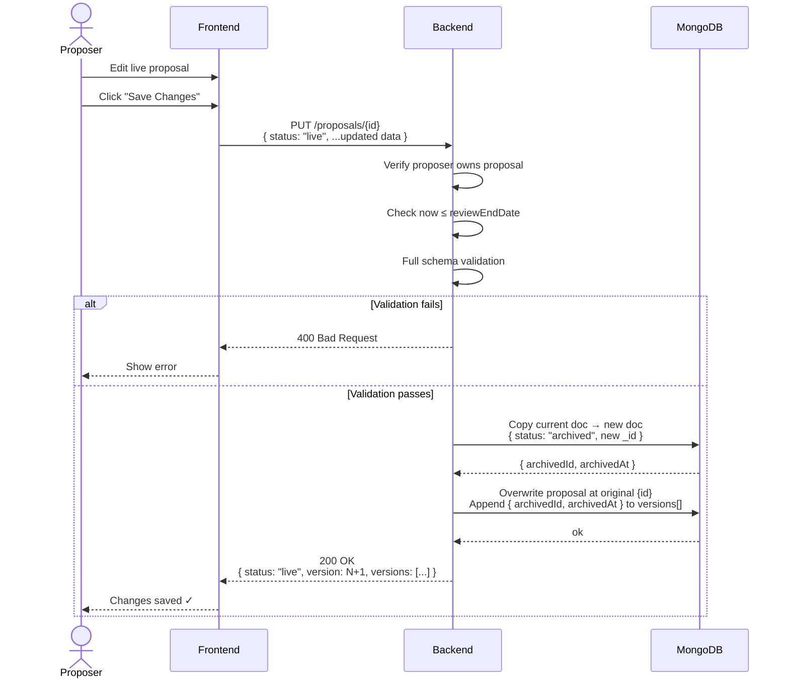
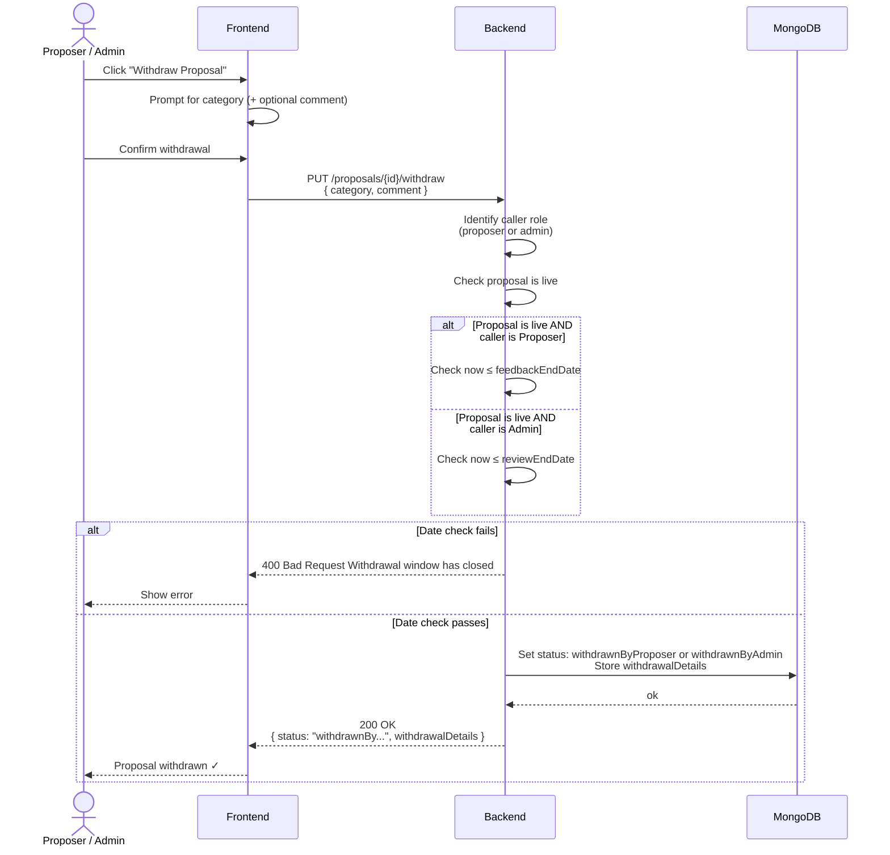
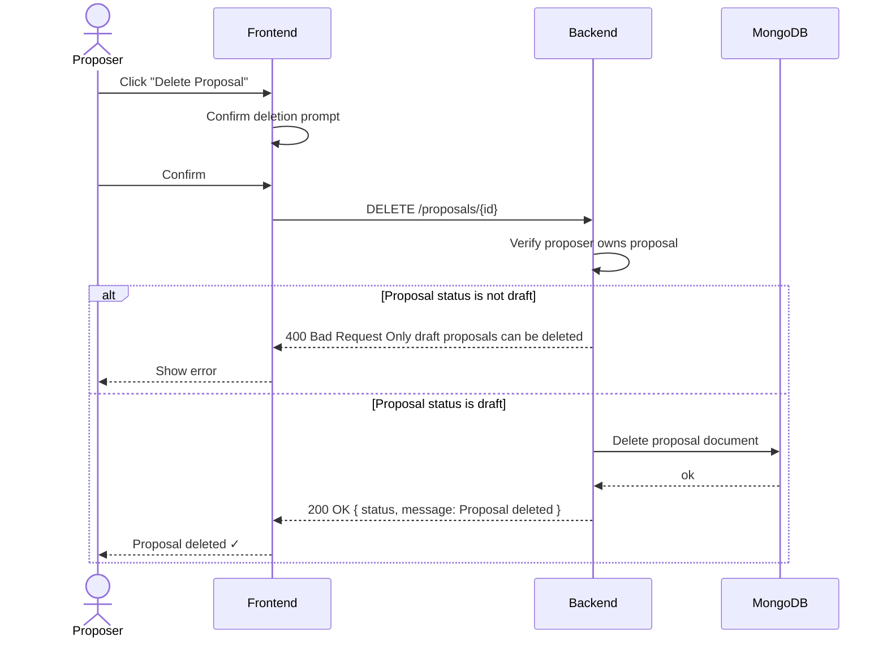

# Proposal flow — draft, save, and submit

---

| Field              | Detail                                                                                                  |
|--------------------|---------------------------------------------------------------------------------------------------------|
| **Document Title** | Proposal Flow – Draft, Save, and Submit                                                                 |
| **Version**        | 0.1.5                                                                                                   |
| **Created**        | February 18, 2026                                                                                       |
| **Last Revised**   | July 23, 2026                                                                                           |
| **Companion Doc**  | [System Architecture Specification](system-architecture.md) · [API Specification](api-specification.md) |
| **Prepared By**    | Adam Dean · <adam@crypto2099.io>, Mad Orkestra · <mad@madorkestra.com>                                  |
| **Status**         | Draft                                                                                                   |

---

This document describes the **proposal lifecycle** and the rule that
**drafts can be saved without full validation** until the proposal status is set
to **live**. It complements the [API Specification](api-specification.md) and
the [Proposal schema description](proposal-schema-description.md).

---

## 1. Principle: draft vs live validation

- **Draft proposals** — The user must be able to **save drafts at any time** without the system enforcing full proposal validation. Partial or incomplete data is allowed. The API accepts create/update requests for proposals with `status: "draft"` without requiring every mandatory field or legal declarations.
- **Live proposals** — When the user **submits** the proposal (i.e. sets `status` to `"live"`), the system **must** validate the full proposal (including all required fields and legal declarations). The API rejects the request with `400 Bad Request` if validation fails (e.g. missing legal declarations or submission outside the vote window).

---

## 2. Proposal statuses

| Status                | Meaning                                                                                                                                                       |
|-----------------------|---------------------------------------------------------------------------------------------------------------------------------------------------------------|
| `draft`               | Work in progress. Visible only to the proposer (and vote admins for that vote). Can be saved repeatedly without full validation. Can be deleted.              |
| `live`                | Submitted for review. Visible publicly. Full validation applied at transition from draft → live. Status is immutable once live (cannot be set back to draft). |
| `withdrawnByProposer` | Withdrawn by the proposer.                                                                                                                                    |
| `withdrawnByAdmin`    | Withdrawn by a vote admin.                                                                                                                                    |
| `archived`            | Previous version of a live proposal after an update (historical copy).                                                                                        |

---

## 3. User actions and API mapping

### 3.1 Create proposal (draft)

- **User:** Starts a new proposal (e.g. “Create proposal” in a vote).
- **API:** `POST /proposals` with `voteId`, `title`, `summary` (optional for draft), `metaData` (can be minimal), and optionally `status: "draft"` (default).
- **Validation:** Only basic requirements (e.g. valid `voteId`, valid structure). **No** requirement for complete `metaData`, legal declarations, or other mandatory fields from the full schema.
- **Result:** Proposal is created with `status: "draft"`. User can continue editing and saving.

### 3.2 Save draft

- **User:** Saves the proposal without submitting (e.g. "Save draft").
- **API:** `PUT /proposals/{proposalId}` with current form data and
  **`status: "draft"`** (or omit status to leave it unchanged).
- **Validation:** Same as create — **no** full schema or legal-declarations
  validation. Partial data is acceptable.
- **Result:** Proposal is updated. User can keep editing and saving until they
  submit.

### 3.3 Submit proposal (draft → live)

- **User:** Clicks "Submit" (or equivalent), confirming they want the proposal
  to become visible and reviewed.
- **API:** `PUT /proposals/{proposalId}` with the full proposal body and
  **`status: "live"`** (or create with `POST /proposals` and `status: "live"`).
- **Validation:** **Full validation** applies:
  - All required fields per [proposal-schema-description.md](proposal-schema-description.md) and API spec.
  - **Legal declarations** required and all four checkboxes must be `true` (see [api-specification.md §5.1](api-specification.md#51-post-proposals)).
  - Current time must be within the vote’s **submission window** (`submissionStartDate` ≤ now ≤ `submissionEndDate`).
- **Result:** If validation passes, proposal becomes `live`. If validation fails, API returns `400 Bad Request` with an error message; proposal remains `draft`.

### 3.4 Update a live proposal

- **User:** Edits an already-submitted (live) proposal.
- **API:** `PUT /proposals/{proposalId}` with updated data. **`status` must
  remain `"live"`** (server rejects any attempt to change status).
- **Behavior:** Server creates an **archived** copy of the current version, then
  updates the proposal in place and appends the previous version to
  `versions`
  (
  see [api-specification.md §5.2](api-specification.md#52-put-proposalsproposalid)).

### 3.5 Withdraw proposal

- **User (proposer or vote admin):** Withdraws a **live** proposal.
- **API:** `PUT /proposals/{proposalId}/withdraw` with `category` and `comment` (both required). See [api-specification.md §5.3](api-specification.md#53-put-proposalsproposalidwithdraw).
- **Constraints:** Only **live** proposals can be withdrawn. Proposer can withdraw until the vote’s `feedbackEndDate`, admin until `reviewEndDate`. Draft proposals cannot be withdrawn; use **Delete proposal** (§3.6) instead.

### 3.6 Delete proposal

- **User:** Deletes a **draft** proposal.
- **API:** `DELETE /proposals/{proposalId}`. Only proposals with
  `status: "draft"` can be deleted
  (
  see [api-specification.md §5.4](api-specification.md#54-delete-proposalsproposalid)).

---

## 4. Submission window (vote dates)

- **Draft create/update:** Allowed while current time is **before** the vote’s `submissionEndDate`. No requirement for `submissionStartDate`.
- **Submit (draft → live):** Current time must be **between** `submissionStartDate` and `submissionEndDate` (inclusive). Requests outside this window receive `400 Bad Request` with a message about the submission window (see [api-specification.md §5.1](api-specification.md#51-post-proposals)).

---

## 5. Legal declarations (required only when live)

When `status` is `"live"`, the API and backend require:

- Presence of `metaData.legalDeclarations`.
- All four boolean fields `true`: `dataProtection`, `publicVisibilityConsent`,
  `authorizationEntity`, `authorizationAttestation`.
- Optional but recommended: `submitterName`, `submitterRole`, `submitterEmail`
  (see [api-specification.md](api-specification.md)
  and [proposal-schema-description.md](proposal-schema-description.md)).

When `status` is `"draft"`, **none** of these are required for save. The
frontend may collect them at any time, but the backend does not enforce them
until the proposal is set to live.

---

## 6. Frontend implications

- **Draft save:** Call `PUT /proposals/{proposalId}` (or `POST /proposals` for
  new) with `status: "draft"` and current form data. Do **not** block save on
  full client-side validation; allow partial data so the user can save progress.
- **Submit (go live):** Before calling the API with `status: "live"`, the
  frontend **should** run full client-side validation (e.g. Zod schema) and show
  errors so the user can fix them. The API will still enforce the same rules and
  return `400` if something is missing or invalid.
- **UX:** Clearly separate "Save draft" (no validation gate) from "Submit"
  (validation required; may show errors or confirm legal declarations).

---

## 7. Summary

| Action          | Status in request  | Full validation? | Legal declarations required? |
|-----------------|--------------------|------------------|------------------------------|
| Create proposal | `draft` (default)  | No               | No                           |
| Save draft      | `draft`            | No               | No                           |
| Submit          | `live`             | Yes              | Yes (all four checkboxes)    |
| Update live     | `live` (unchanged) | Yes              | Yes (already satisfied)      |
| Withdraw        | —                  | N/A              | N/A                          |
| Delete          | — (draft only)     | N/A              | N/A                          |

**Users can save drafts without validation until the proposal status changes to
live.**

---

## Revision History

This document follows [Semantic Versioning 2.0.0](https://semver.org/). Version
numbers use the form **MAJOR.MINOR.PATCH**:

- **MAJOR** — Incompatible flow or contract changes (e.g. different validation
  rules, removed actions).
- **MINOR** — Backwards-compatible additions (e.g. new actions, new
  constraints).
- **PATCH** — Backwards-compatible fixes and clarifications (e.g. typo
  corrections, alignment with implementation).

| Version | Date       | Description                                                                                                                                                                   |
|---------|------------|-------------------------------------------------------------------------------------------------------------------------------------------------------------------------------|
| 0.1.5   | 2026-07-23 | Align draft delete success with API: `200 OK` JSON instead of `204 No Content` (F-027).                                                                                         |
| 0.1.4   | 2026-02-20 | Terminology change, modify references to "Budgets" to be "Votes"                                                                                                              |
| 0.1.3   | 2026-02-19 | Remove the concept/ability to "withdraw" a draft proposal. Draft proposals may be deleted by the author, otherwise only live proposals may be withdrawn by admin or the user. |
| 0.1.2   | 2026-02-19 | Add sequence diagrams and flowcharts for documenting various state changes of proposals.                                                                                      |
| 0.1.1   | 2026-02-19 | Grammar, formatting, and minor tweaks and changes.                                                                                                                            |
| 0.1.0   | 2026-02-18 | Document metadata block and revision history. Fixed: create uses `summary` (not `description`); withdraw applies to live or draft, date limits only for live.                 |
