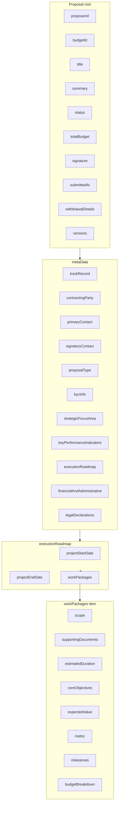

# Proposal Schema vs CBC Template – Documentation and Gap Analysis

This document compares [schema/Proposal.js](../schema/Proposal.js) with the CBC Proposal Template FORM Final DRAFT PDF: proposal structure, field mapping, remaining schema issues, and improvements.

---

## 1. CBC template structure (reference)

The PDF defines five main sections plus legal declarations:

| Section                          | PDF section | Key fields                                                                                                                                                                                                                                                                                                                                                   |
| -------------------------------- | ----------- | ------------------------------------------------------------------------------------------------------------------------------------------------------------------------------------------------------------------------------------------------------------------------------------------------------------------------------------------------------------ |
| 1. Project Definition            | 1           | Proposal Title *, Executive Summary *, Track Record                                                                                                                                                                                                                                                                                                          |
| 2. Strategic Roadmap Alignment   | 2           | Strategic Focus Area *, KPIs * (multi-select or custom; each with title + Contribution Strategy *)                                                                                                                                                                                                                                                           |
| 3. Execution Roadmap             | 3           | Timeline * (start/end), Work Packages (name, scope, supporting docs, objectives, expected value, metric), Milestones per WP (name, deliverables, acceptance criteria, duration), Budget breakdown, ada/USD conversion rate *                                                                                                                                 |
| 4. Administrative & Verification | 4           | Intersect Administrator? *, Contracting Party (company vs individual), company/individual fields, Primary Contact, Signatory, Total Proposals Submitted, KYC/KYB *, Treasury Repayment *, Repayment Circumstances, Initiative Type *, Type of Proposal, Prior Funding *, Treasury Donation Hash *, Third Party Assurers, Other Supporting Info (title + URL) |
| 5. Legal Declarations            | 0 in PDF    | Data Protection (2 checkboxes), Anti-Bribery, Authenticity & IP, Conflicts, Compliance, Sanctions, No Contract/No Guarantee, Declaration of Submitter (name, role, email + 2 checkboxes)                                                                                                                                                                     |

---

## 2. Field-by-field mapping: schema vs template

### 2.1 Top-level and Project Definition

| CBC field           | Schema location        | Status  |
| ------------------- | ---------------------- | ------- |
| Proposal Title *    | `title`                | Covered |
| Executive Summary * | `summary`              | Covered |
| Track Record        | `metaData.trackRecord` | Covered |

### 2.2 Strategic Roadmap Alignment

The CBC template allows selecting pre-defined KPIs or adding custom ones; both are represented the same way. No separate "Custom KPI" field is needed: the `keyPerformanceIndicators` array holds one object per KPI (whether from the category list or user-defined), each with a title and contribution strategy.

| CBC field                         | Schema location                                            | Status                                                                           |
| --------------------------------- | ---------------------------------------------------------- | -------------------------------------------------------------------------------- |
| Strategic Focus Area *            | `metaData.strategicFocusArea` (ref Category)               | Covered                                                                          |
| Key Performance Indicators *      | `metaData.keyPerformanceIndicators[]`                      | Covered (each item: title + contributionStrategy; title is pre-filled or custom) |
| Contribution Strategy * (per KPI) | `metaData.keyPerformanceIndicators[].contributionStrategy` | Covered                                                                          |

### 2.3 Execution Roadmap

| CBC field                                                       | Schema location                                                                                   | Status                                                                            |
| --------------------------------------------------------------- | ------------------------------------------------------------------------------------------------- | --------------------------------------------------------------------------------- |
| Timeline start/end *                                            | `metaData.executionRoadmap.projectStartDate/EndDate`                                              | Covered                                                                           |
| Work Package name *                                             | `executionRoadmap.workPackages[].title`                                                           | Covered (name stored as `title`)                                                  |
| Scope of Work *                                                 | `workPackages[].scope`                                                                            | Covered                                                                           |
| Supporting Documentation Link (title + URL)                     | `workPackages[].supportingDocuments` (array of `{ title, url }`)                                  | Covered (added to schema)                                                         |
| Core Objectives *                                               | `workPackages[].coreObjectives[]`                                                                 | Covered                                                                           |
| Expected Value (ROI) *                                          | `workPackages[].expectedValue`                                                                    | Covered                                                                           |
| Metric *                                                        | `workPackages[].metric`                                                                           | Covered                                                                           |
| Milestone (name, deliverables, acceptance criteria, duration)   | `workPackages[].milestones[]` (`milestoneName`, `deliverables`, `acceptanceCriteria`, `duration`) | Covered (added to schema)                                                         |
| Budget breakdown (category, description, qty, unit cost, total) | `workPackages[].budgetBreakdown[]`                                                                | Covered (schema uses `unitPrice`/`total`; frontend uses `unitCostAda`/`totalAda`) |
| ada/USD conversion rate *                                       | `metaData.financialAndAdministrative.conversionRate`                                              | Covered                                                                           |
| WP-level estimatedDuration                                      | `workPackages[].estimatedDuration`                                                                | In schema; PDF emphasizes per-milestone duration                                 |

### 2.4 Administrative & Verification

| CBC field                                                                                             | Schema location                                                                                            | Status                                                                                                                                                                                    |
| ----------------------------------------------------------------------------------------------------- | ---------------------------------------------------------------------------------------------------------- | ----------------------------------------------------------------------------------------------------------------------------------------------------------------------------------------- |
| Intersect Administrator? *                                                                            | `financialAndAdministrative.intersectAdministrator` (Boolean), `otherAdministrators` (String)              | Covered (added to schema)                                                                                                                                                                 |
| Contracting Party (company/individual)                                                                | `metaData.contractingParty.legalEntityType`                                                                | Covered (enum "company" \| "individual")                                                                                                                                                  |
| Company: Legal Entity Name *, Registration Number *, Country of Incorporation *, Registered Address * | `contractingParty`: legalEntityName, legalEntityRegistrationNumber, legalEntityCountry, legalEntityAddress | Covered                                                                                                                                                                                   |
| Individual: Country of Residence *, Govt Issued ID *, Full Residential Address *                      | `contractingParty`                                                                                         | **Partial**: schema reuses legalEntityCountry/Address/RegistrationNumber; PDF expects distinct **countryOfResidence**, **govtIssuedIdNumber**, **fullResidentialAddress** for individuals |
| Primary Contact (name *, email *, X Handle)                                                           | `metaData.primaryContact` (name, title, email, socialMedia)                                                | Covered (socialMedia = X Handle; PDF does not require Primary Contact "title")                                                                                                            |
| Signatory (name *, title *, email *, authorization *)                                                 | `metaData.signatoryContact`                                                                                | Covered                                                                                                                                                                                   |
| Total Proposals Submitted                                                                             | —                                                                                                          | **Missing** in schema; frontend has `totalProposalsSubmitted`                                                                                                                             |
| KYC/KYB Submitted? *, KYC Contact Email (if No)                                                       | `metaData.kycInfo` (submitted, email)                                                                      | Covered                                                                                                                                                                                   |
| Treasury Repayment? *, Repayment Circumstances                                                        | `financialAndAdministrative.treasuryRepayment`, `treasuryRepaymentCondition`                               | Covered                                                                                                                                                                                   |
| Initiative Type *                                                                                     | `financialAndAdministrative.initiativeType`                                                                | Covered (enum `"New Initiative"` \| `"Maintenance"` per PDF)                                                                                                                                                 |
| Type of Proposal                                                                                      | `metaData.proposalType`                                                                                    | Covered (enum `"Technical (software/IT)"` \| `"Non-technical"` per PDF)                                                                                                                                       |
| Prior Funding *                                                                                       | `financialAndAdministrative.priorFunding`                                                                  | Covered                                                                                                                                                                                   |
| Treasury Donation Verification Hash *                                                                 | `financialAndAdministrative.treasuryDonationHash`                                                          | Covered                                                                                                                                                                                   |
| Third Party Assurers                                                                                  | `financialAndAdministrative.thirdPartyAssurers` (String)                                                   | Covered (added to schema)                                                                                                                                                                 |
| Other Supporting Info (link title + URL)                                                              | `financialAndAdministrative.supportingDocuments` (array of `{ title, url }`)                               | Covered (schema updated)                                                                                                                                                                  |

### 2.5 Legal Declarations (PDF: "0. Proposal Submission Legal Declarations")

The PDF defines eight numbered declarations. Each maps to schema or missing fields as below.

| PDF § | PDF title / content                                                                                                                                                                                                                                             | Schema location                                                                                                                                             | Status                                                                                                                                                                                                       |
| ----- | --------------------------------------------------------------------------------------------------------------------------------------------------------------------------------------------------------------------------------------------------------------- | ----------------------------------------------------------------------------------------------------------------------------------------------------------- | ------------------------------------------------------------------------------------------------------------------------------------------------------------------------------------------------------------ |
| **1** | **Data Protection** — (1) Consent to data processing and sharing with internal stakeholders for evaluation, voting, contracting, treasury execution. (2) Acknowledge that legal entity name, personal name, and X handle will be publicly visible.              | `legalDeclarations.dataProtection` (single boolean)                                                                                                         | **Partial**: PDF has two checkboxes; schema has one. Frontend has `dataProcessingConsent` and `publicVisibilityConsent`. Need `dataProcessingConsent` + `publicVisibilityConsent` (or equivalent) in schema. |
| **2** | **Anti-Bribery and Anti-Corruption** — No bribes, improper payments, or inducements.                                                                                                                                                                            | `legalDeclarations.antiBribery`                                                                                                                             | Covered                                                                                                                                                                                                      |
| **3** | **Proposal Authenticity and Intellectual Property** — Proposal original; information accurate and complete; no third-party rights preventing execution; vendor retains pre-existing IP; proposals confidential and used solely for evaluation.                  | `legalDeclarations.authenticity`, `legalDeclarations.ipOwnership`                                                                                           | Covered (schema splits as authenticity + ipOwnership)                                                                                                                                                        |
| **4** | **Conflicts with Existing Obligations** — Accepting the contract (if awarded) would not violate existing obligations.                                                                                                                                           | `legalDeclarations.conflicts`                                                                                                                               | Covered                                                                                                                                                                                                      |
| **5** | **Compliance with Laws and Regulations** — Compliance with applicable laws, regulations, and export controls.                                                                                                                                                   | `legalDeclarations.compliance`                                                                                                                              | Covered                                                                                                                                                                                                      |
| **6** | **Sanctions / Restricted Parties** — Neither vendor nor associated parties are on relevant sanctions lists.                                                                                                                                                     | `legalDeclarations.sanctions`                                                                                                                               | Covered                                                                                                                                                                                                      |
| **7** | **No Contract Formation / Limitation of Liability** — (1) Submission does not create a contract, obligation, or entitlement to award. (2) Submission does not guarantee approval; only DReps have authority to vote and approve; DReps reserve sole discretion. | `legalDeclarations.noContract`, `legalDeclarations.noGuarantee`                                                                                             | Covered                                                                                                                                                                                                      |
| **8** | **Declaration of Submitter** — Name, Role, Email (text inputs). Checkbox (1): Authorized to submit on behalf of vendor; submission does not constitute authority to bind entity. Checkbox (2): Authorized to submit and attest to all legal declarations above. | `authorizationEntity`, `authorizationAttestation` (the two checkboxes). Submitter identity: **Missing** `submitterName`, `submitterRole`, `submitterEmail`. | **Partial**: Schema has the two checkboxes as `authorizationEntity` and `authorizationAttestation`. Missing: submitter name, role, email (frontend has these in declarations).                               |

---

## 3. Schema errors and bugs (remaining)

- **3.1 Mongoose `properties` usage**: For `contractingParty`, `primaryContact`, `signatoryContact`, and `legalDeclarations`, using `properties: { ... }` inside `type: Object` does not create real Mongoose sub-schemas (no validation or casting). For proper validation and structure, these should be defined as nested schemas (e.g. `new Schema({ ... })`) or with explicit `type` per key in [schema/Proposal.js](../schema/Proposal.js).

---

## 4. Value and shape mismatches (frontend ↔ backend)

- **proposalType** and **initiativeType**: Schema uses PDF values `"Technical (software/IT)"` \| `"Non-technical"` and `"New Initiative"` \| `"Maintenance"`. Frontend form uses normalized values (`"technical"` \| `"non-technical"`, `"new"` \| `"maintenance"`); API client or backend should map these when submitting. Supporting links are aligned.

---

## 5. Summary: missing fields in schema

| Area            | Missing field(s)                                                                                                                                                                                                                                                                   |
| --------------- | ---------------------------------------------------------------------------------------------------------------------------------------------------------------------------------------------------------------------------------------------------------------------------------- |
| Strategic       | None (KPIs use `keyPerformanceIndicators[]` with `title` + `contributionStrategy` for both pre-filled and custom KPIs)                                                                                                                                                             |
| Execution       | None (per-WP `supportingDocuments` and `milestones` are in schema)                                                                                                                                                                                                                 |
| Administrative  | `totalProposalsSubmitted` (number or string); individual-specific: `countryOfResidence`, `govtIssuedIdNumber`, `fullResidentialAddress` (or clear mapping from existing legalEntity* fields). `intersectAdministrator`, `otherAdministrators`, `thirdPartyAssurers` are in schema. |
| Financial/Admin | None (`supportingDocuments` is now array of `{ title, url }`)                                                                                                                                                                                                                      |
| Legal           | Split data protection into two booleans (e.g. `dataProtectionConsent`, `publicVisibilityConsent`); add **Declaration of Submitter**: `submitterName`, `submitterRole`, `submitterEmail`, `authorizedToSubmit`, `authorizedToAttest`                                                |

---

## 6. List of improvements (prioritized, remaining)

1. **Fix schema bugs**
   - Define `contractingParty`, `primaryContact`, `signatoryContact`, `legalDeclarations` as proper nested schemas for validation (see §3).
2. **Align with CBC template – administrative**
   - Add `totalProposalsSubmitted` (number or string).
   - For individuals: add or clearly map `countryOfResidence`, `govtIssuedIdNumber`, `fullResidentialAddress` in `contractingParty` (or conditional sub-object).
3. **Align with CBC template – legal**
   - Replace single `dataProtection` with two booleans (e.g. `dataProcessingConsent`, `publicVisibilityConsent`).
   - Add submitter declaration: `submitterName`, `submitterRole`, `submitterEmail`; keep `authorizedToSubmit` and `authorizedToAttest` (already in schema as `authorizationEntity`, `authorizationAttestation`).
4. **Documentation**
   - Add or update a **Proposal structure** doc: (a) list all schema paths, (b) map to CBC template sections and field names, (c) note required/optional and character limits, (d) document enums. Update [api-specification.md](api-specification.md) so examples and metaData tables match the schema.

---

## 7. Diagram: high-level proposal structure

**Legend**: Current schema; `workPackages` item includes `supportingDocuments` and `milestones`. `financialAndAdministrative` includes `intersectAdministrator`, `otherAdministrators`, `thirdPartyAssurers`, and `supportingDocuments: [{ title, url }]`; still missing `totalProposalsSubmitted`. `legalDeclarations` is missing split data protection and submitter declaration.

---

## 8. Deliverables (when implementing)

- **Single source doc**: e.g. `docs/proposal-structure.md` (or section in existing docs) with:
  - CBC section → schema path table (as in §2).
  - Required/optional and constraints (max length, enums).
  - Notes on "Not Public" fields from PDF where applicable.
- **Schema changes**: Apply fixes and additions above in [schema/Proposal.js](../schema/Proposal.js).
- **API spec**: Update [api-specification.md](api-specification.md) and any OpenAPI/spec so examples and field tables match the corrected schema and new fields.
- **Frontend/API mapping**: Ensure form payload mapping (e.g. in Form.svelte or API client) sends the new and corrected fields and aligns enum values with backend (or backend accepts normalized values and stores them).
