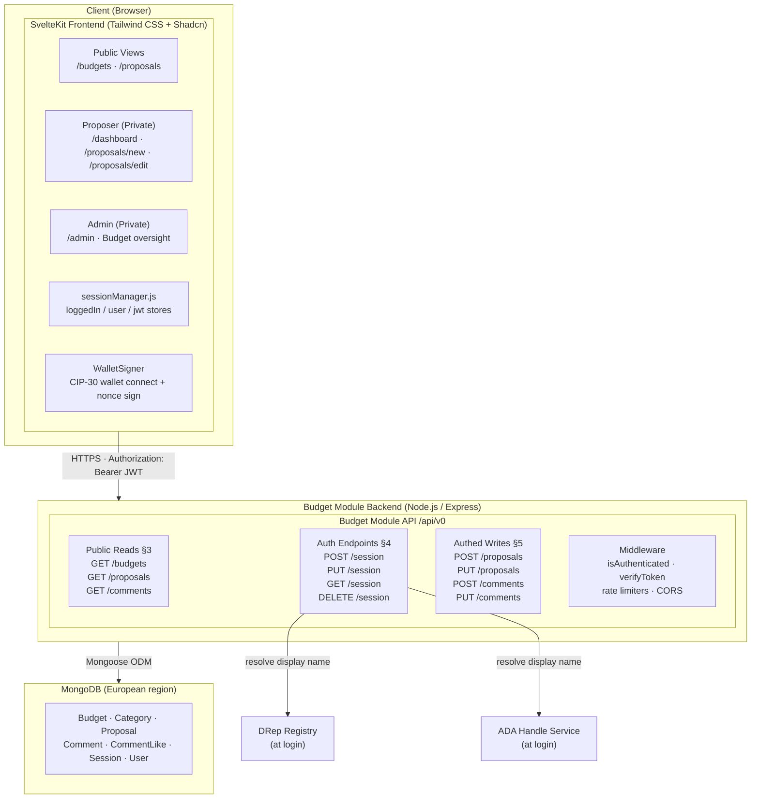
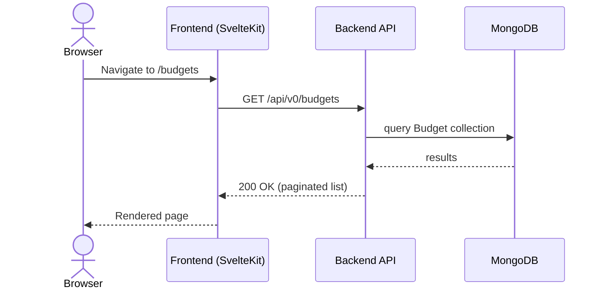
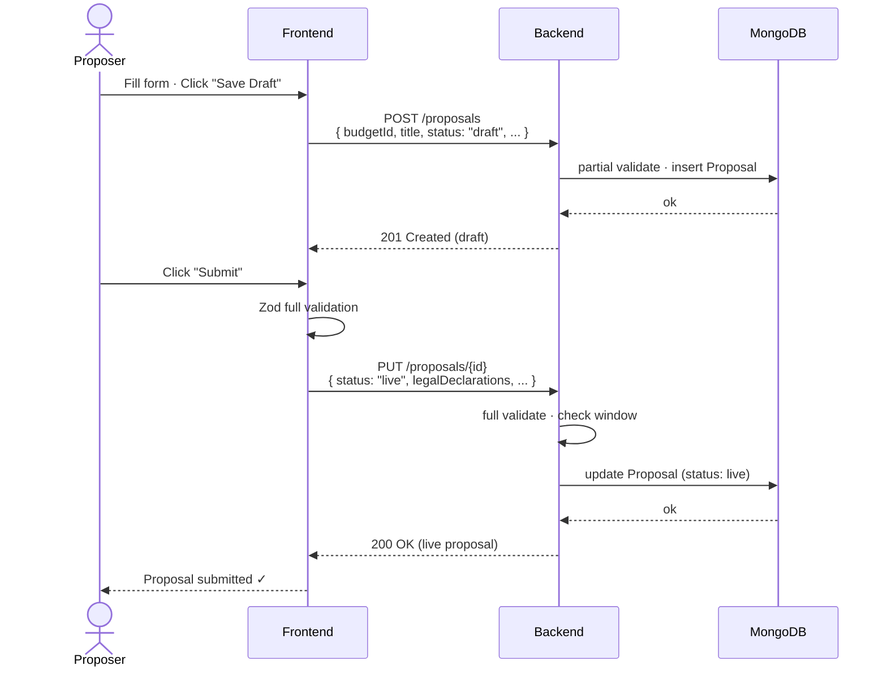
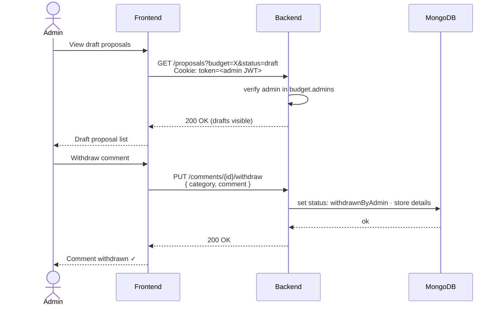

# Ekklesia Budget Module — System Architecture

---

| Field              | Detail                                                                 |
|--------------------|------------------------------------------------------------------------|
| **Document Title** | System Architecture                                                    |
| **Version**        | 0.1.0                                                                  |
| **Created**        | February 19, 2026                                                      |
| **Last Revised**   | February 19, 2026                                                      |
| **Companion Doc**  | Ekklesia Integration Plan · [API Specification](api-specification.md)  |
| **Prepared By**    | Adam Dean · <adam@crypto2099.io>, Mad Orkestra · <mad@madorkestra.com> |
| **Status**         | Draft                                                                  |

---

## Table of Contents

- [Ekklesia Budget Module — System Architecture](#ekklesia-budget-module--system-architecture)
    - [Table of Contents](#table-of-contents)
    - [1. Purpose \& Scope](#1-purpose--scope)
    - [2. High-Level Component Overview](#2-high-level-component-overview)
    - [3. Component Descriptions](#3-component-descriptions)
        - [3.1 Frontend (SvelteKit)](#31-frontend-sveltekit)
        - [3.2 Backend API (Node.js / Express)](#32-backend-api-nodejs--express)
        - [3.3 Database (MongoDB)](#33-database-mongodb)
        - [3.4 Authentication Layer](#34-authentication-layer)
        - [3.5 Ekklesia Authentication Integration](#35-ekklesia-authentication-integration)
        - [3.6 External Services](#36-external-services)
    - [4. System Architecture Diagram](#4-system-architecture-diagram)
    - [5. Data Flow](#5-data-flow)
        - [5.1 Unauthenticated Read Flow](#51-unauthenticated-read-flow)
        - [5.2 Wallet Authentication Flow](#52-wallet-authentication-flow)
        - [5.3 Proposal Create / Submit Flow](#53-proposal-create--submit-flow)
        - [5.4 Admin Moderation Flow](#54-admin-moderation-flow)
    - [6. Role-Based Access Control Summary](#6-role-based-access-control-summary)
    - [7. Infrastructure \& Deployment](#7-infrastructure--deployment)
    - [8. Security Considerations](#8-security-considerations)
    - [9. Out of Scope (MVP)](#9-out-of-scope-mvp)
    - [Revision History](#revision-history)

---

## 1. Purpose & Scope

This document describes the system architecture for the Ekklesia Budget Module —
a standalone proposal lifecycle management platform built for Intersect MBO. The
Budget Module is a separate application stack from the Ekklesia Voting Module (
`ekklesia.vote`), sharing only the Ekklesia authentication flow (wallet-based
challenge-response and JWT session management) as a common integration point.

The Budget Module enables:

- Proposers to create, edit, submit, and withdraw funding proposals within
  defined budget cycles.
- DReps and authenticated users to view proposals and submit comments during
  feedback periods.
- Budget admins to oversee proposals and moderate comments within their assigned
  budgets.
- Public (unauthenticated) viewers to browse live proposals and comments.

This document covers the major components, their responsibilities, how they
interact, and the deployment topology. It should be read alongside
the [API Specification](api-specification.md) and the Ekklesia Integration Plan.

---

## 2. High-Level Component Overview

The Budget Module is a self-contained application composed of four primary
components:

| Component       | Technology                                     | Responsibility                                                 |
|-----------------|------------------------------------------------|----------------------------------------------------------------|
| **Frontend**    | SvelteKit + Tailwind CSS + Shadcn              | UI, routing, session management, form validation               |
| **Backend API** | Node.js + Express                              | Business logic, access control, data validation, JWT issuance  |
| **Database**    | MongoDB (Mongoose)                             | Persistent storage for all Budget Module data                  |
| **Auth Layer**  | Ekklesia auth (CIP-30 wallet / CLI credential) | Identity verification, nonce challenge-response, JWT lifecycle |

The auth layer is the sole integration point with the Ekklesia ecosystem — the
Budget Module implements the same wallet-signature challenge-response flow and
JWT session pattern used by the Ekklesia Voting Module, but runs its own
independent auth endpoints, database, and session store. Two external services
are called at login time (DRep registry, ADA handle service) to resolve user
display names.

---

## 3. Component Descriptions

### 3.1 Frontend (SvelteKit)

The frontend is a SvelteKit single-page application served from the Budget
Module's own domain. It is styled with Tailwind CSS and Shadcn UI components.

**Key responsibilities:**

- Rendering proposal list and detail views, budget cycle pages, and category
  filters.
- Hosting the proposal creation and editing form, with draft-save (partial
  validation) and submit (full validation via Zod schema) flows.
- Managing session state via `sessionManager.js` (stores: `loggedIn`, `user`,
  `jwt`). The JWT is persisted to both an HTTP-only cookie and `localStorage` as
  a fallback.
- Providing the `WalletSigner` UI component for CIP-30 wallet connection and the
  nonce sign-in flow.
- Protecting private routes under the `(private)` SvelteKit layout, which
  validates the session cookie on load and redirects unauthenticated users to
  `/`.
- Calling the backend API via a shared `api.fetch` helper that injects the JWT (
  `Authorization: Bearer`) and handles 401 responses by triggering logout.

**Routing structure (high level):**

| Route                          | Access              | Description                   |
|--------------------------------|---------------------|-------------------------------|
| `/budgets`                     | Public              | Budget cycle listing          |
| `/budgets/{slug}`              | Public              | Budget detail + proposal list |
| `/proposals/{proposalId}`      | Public / Role-gated | Proposal detail view          |
| `/proposals/new`               | Proposer            | Create new proposal           |
| `/proposals/{proposalId}/edit` | Proposer (owner)    | Edit draft or live proposal   |
| `/dashboard`                   | Authenticated       | User's own proposals          |
| `/admin`                       | Admin               | Budget admin oversight        |

### 3.2 Backend API (Node.js / Express)

The backend is a standalone Node.js/Express application serving the Budget
Module API under the versioned base path `/api/v0`.

**Key responsibilities:**

- Exposing all public read endpoints (budgets, proposals, comments) with
  pagination, filtering, sorting, and search.
- Enforcing role-based access control on authenticated write endpoints (
  proposals, comments, likes, withdrawals) using `isAuthenticated` middleware
  and `req.userId` / `req.signType` from the verified JWT.
- Implementing the proposal lifecycle state machine: `draft` → `live` →
  `withdrawnByProposer` / `withdrawnByAdmin`; versioning on live proposal
  updates (archived copies).
- Issuing and validating JWTs (`JWT_SECRET`, `JWT_MAX_AGE`) for the
  challenge-response authentication flow.
- Applying rate limiting per IP (public endpoints: 200 req/min; auth endpoints:
  5–60 req/min; write endpoints: 10 req/user/min).
- Applying server-side response caching (30 s TTL) on public read endpoints.
- Enforcing budget submission windows (`submissionStartDate`,
  `submissionEndDate`, `feedbackEndDate`, `reviewEndDate`) on all time-gated
  operations.

**Primary route groups:**

| Path prefix                                                        | Section              | Description                             |
|--------------------------------------------------------------------|----------------------|-----------------------------------------|
| `GET /budgets[/...]`                                               | §3                   | Budget and category reads               |
| `GET /proposals[/...]`                                             | §3                   | Proposal reads (role-filtered)          |
| `GET /comments[/...]`                                              | §3                   | Comment and reply reads (role-filtered) |
| `POST /session`, `PUT /session`, `GET /session`, `DELETE /session` | §4                   | Auth: nonce, verify, validate, logout   |
| `POST                                                              | PUT                  | DELETE /proposals[/...]`                | §5 | Proposal writes |
| `POST                                                              | PUT /comments[/...]` | §5                                      | Comment writes, likes, withdrawals |

**Key middleware:**

| Middleware                   | Purpose                                                     |
|------------------------------|-------------------------------------------------------------|
| `isAuthenticated`            | Validates JWT cookie; attaches `req.userId`, `req.signType` |
| `validateSessionRequest`     | Validates `signerAddress` and `signType` on auth endpoints  |
| `nonceRequestLimiter`        | Rate limits `POST /session` (5/min per IP)                  |
| `sessionVerificationLimiter` | Rate limits `PUT /session` (10/min per IP)                  |

### 3.3 Database (MongoDB)

MongoDB is used as the primary data store, accessed via Mongoose ODM. All
collections reside in a single database instance. Data is stored in a
European-region hosting environment (see §7).

**Collections:**

| Collection    | Schema doc                                                       | Description                                                                 |
|---------------|------------------------------------------------------------------|-----------------------------------------------------------------------------|
| `Budget`      | [budget-schema-description.md](budget-schema-description.md)     | Budget cycles with date windows and admin arrays                            |
| `Category`    | _(pending schema doc)_                                           | Categories belonging to a budget; ordered by `sortOrder`                    |
| `Proposal`    | [proposal-schema-description.md](proposal-schema-description.md) | Proposal lifecycle documents including versioning, withdrawal, and metadata |
| `Comment`     | [comment-schema-description.md](comment-schema-description.md)   | Top-level comments and replies on proposals                                 |
| `CommentLike` | [comment-schema-description.md](comment-schema-description.md)   | One document per user-comment like; unique index on `(commentId, userId)`   |
| `Session`     | _(login-flow.md)_                                                | Short-lived nonce sessions; TTL-indexed (expires ~1 hr)                     |
| `User`        | _(pending schema doc)_                                           | User display names and last login; keyed by Bech32 `userId`                 |

**Indexes of note:**

- `Session`: TTL index on `createdAt` (auto-expire after 1 hour); index on
  `userId` for nonce lookup.
- `CommentLike`: Unique compound index on `(commentId, userId)`.
- `Proposal`: Index on `(budgetId, status)` for filtered list queries; index on
  `proposerId` for owner queries.
- `Comment`: Index on `(proposalId, parentId, status)` for top-level and reply
  fetches.

### 3.4 Authentication Layer

The Budget Module implements the Ekklesia wallet-signature challenge-response
authentication pattern. Users prove ownership of a Cardano address by signing a
one-time nonce; the server verifies the signature and issues a JWT. No passwords
are stored.

**Supported identity types:**

| Type          | Format             | CIP reference                     |
|---------------|--------------------|-----------------------------------|
| Stake address | `stake1…` (bech32) | Standard Cardano stake credential |
| DRep ID       | `drep1…` (bech32)  | CIP-0509 / CIP-0129               |
| Stake pool ID | `pool1…` (bech32)  | Standard pool credential          |

**Flow summary** (detailed in [login-flow.md](login-flow.md)):

1. Client sends `POST /session` with `signerAddress` and `signType` → server
   returns a one-time nonce (`dataHex`).
2. Client signs `dataHex` using the connected wallet (CIP-30 `signData`) or CLI
   credential. For multisig DRep addresses, any single eligible key contained
   within the multisig may sign — full multisig validation is not required to
   obtain a session.
3. Client sends `PUT /session` with the signature → server verifies, issues a
   JWT (`{ userId, signType }`), and sets an HTTP-only `token` cookie.
4. Subsequent authenticated requests are verified by `isAuthenticated`
   middleware reading `req.cookies.token`.

JWT tokens are signed with `JWT_SECRET` and expire per `JWT_MAX_AGE` (default
`1d`). Nonce are single-use, stored in the `Session` collection, and expire
after 5 minutes.

### 3.5 Ekklesia Authentication Integration

The Budget Module is a fully independent application stack — it has its own
frontend, backend, database, and hosting. The sole integration point with the
Ekklesia ecosystem is the **authentication pattern**: the Budget Module
implements the same wallet-signature challenge-response flow, JWT structure, and
session management approach established by the Ekklesia Voting Module.

This means users authenticating to the Budget Module follow an identical UX to
the Ekklesia Voting Module (connect wallet → sign nonce → receive JWT), and the
same Cardano identity types are supported. However, the Budget Module runs its
own auth endpoints and maintains its own `Session` and `User` collections —
there is no shared database, no shared process, and no shared session store
between the two applications.

| Integration point          | Description                                                                                                                                          |
|----------------------------|------------------------------------------------------------------------------------------------------------------------------------------------------|
| **Auth pattern**           | Implements the same wallet-signature challenge-response flow (`POST /session` → sign nonce → `PUT /session`) as the Ekklesia Voting Module           |
| **JWT structure**          | JWT payload shape (`{ userId, signType }`) and cookie configuration (`token`, HTTP-only, `SameSite=Strict`) are consistent with the Ekklesia pattern |
| **Identity types**         | Supports the same Cardano identifier types: `stake1…`, `drep1…`, `pool1…` (bech32)                                                                   |
| **Frontend session store** | `sessionManager.js` pattern (stores: `loggedIn`, `user`, `jwt`) is adopted from the Ekklesia frontend implementation                                 |
| **DRep registry lookup**   | On successful login, the backend queries the DRep registry (external) to resolve a display name for DRep-authenticated users                         |
| **ADA handle service**     | On successful login, the backend queries the ADA handle service (external) to resolve a display name for stake-address-authenticated users           |

### 3.6 External Services

| Service            | When called            | Purpose                                           |
|--------------------|------------------------|---------------------------------------------------|
| DRep registry      | `PUT /session` (login) | Resolve DRep display name for `User` record       |
| ADA handle service | `PUT /session` (login) | Resolve ADA handle display name for `User` record |

These calls are non-blocking for the authentication flow; login succeeds
regardless of whether a display name is resolved. Failures are handled
gracefully and do not prevent JWT issuance.

---

## 4. System Architecture Diagram



---

## 5. Data Flow

### 5.1 Unauthenticated Read Flow



Public read endpoints are rate-limited at 200 req/min per IP and server-side
cached for 30 seconds.

### 5.2 Wallet Authentication Flow

```mermaid
sequenceDiagram
    actor User
    participant Frontend
    participant Backend
    participant MongoDB

    User->>Frontend: Click "Connect Wallet"
    Frontend->>Backend: POST /session<br/>{ signerAddress, signType }
    Backend->>MongoDB: save Session (nonce, userId)
    MongoDB-->>Backend: ok
    Backend-->>Frontend: { dataHex, userId, ... }
    User->>Frontend: signData(dataHex) in wallet
    Frontend->>Backend: PUT /session<br/>{ signerAddress, signType, signature }
    Backend->>MongoDB: verify sig, upsert User, issue JWT
    MongoDB-->>Backend: ok
    Backend-->>Frontend: Set-Cookie: token=<JWT><br/>{ token, expiresIn }
    Frontend-->>User: setJWT(); loggedIn = true
```

### 5.3 Proposal Create / Submit Flow



### 5.4 Admin Moderation Flow



---

## 6. Role-Based Access Control Summary

Access control is enforced in the backend API on every request. The
authenticated user's `userId` (from the JWT) is checked against proposal
`proposerId` fields and budget `admins` arrays to determine role at request
time.

| Role         | Identity                                         | Key permissions                                                                                                                                        |
|--------------|--------------------------------------------------|--------------------------------------------------------------------------------------------------------------------------------------------------------|
| **Public**   | Unauthenticated                                  | Read `live` and `withdrawn` proposals and comments                                                                                                     |
| **User**     | Any authenticated wallet                         | Public access + create and manage own comments                                                                                                         |
| **Proposer** | Authenticated wallet; owns a proposal            | User access + CRUD on own proposals (all statuses); withdraw own live proposals until `feedbackEndDate`                                                |
| **DRep**     | Authenticated via `drep1…` credential            | Same as User in this MVP (view and comment)                                                                                                            |
| **Admin**    | Authenticated wallet; address in `budget.admins` | All of the above + view draft proposals for assigned budgets; withdraw live proposals until `reviewEndDate`; withdraw comments until `feedbackEndDate` |

Admin status is budget-scoped — a user is only an admin for the specific budgets
in which their address appears in the `admins` array. The `GET /session`
endpoint returns `adminBudgetIds` to inform the frontend which budgets the user
can administer.

---

## 7. Infrastructure & Deployment

The Budget Module is deployed as a standalone application, fully independent of
the Ekklesia Voting Module infrastructure. It has its own hosting environment,
its own database instance, and its own deployment pipeline.

| Layer                     | Hosting                                 | Notes                                                                                                   |
|---------------------------|-----------------------------------------|---------------------------------------------------------------------------------------------------------|
| **Frontend**              | Budget Module hosting (European region) | SvelteKit app served from its own domain; no shared origin with `ekklesia.vote`                         |
| **Backend API**           | Budget Module hosting (European region) | Standalone Express process; own environment variables and configuration                                 |
| **Database**              | MongoDB (European region)               | Dedicated MongoDB instance for the Budget Module; no shared collections with the Ekklesia Voting Module |
| **Environment variables** | Budget Module `.env`                    | `JWT_SECRET`, `JWT_MAX_AGE`, `FRONTEND_URL`, `MONGO_URI` scoped to this application only                |

**Data residency:** All user and proposal data must be stored in a
European-region hosting environment. This applies to the MongoDB instance and
any caching layer.

---

## 8. Security Considerations

| Concern                      | Mitigation                                                                                                                                                                                                                                                                                                                                                  |
|------------------------------|-------------------------------------------------------------------------------------------------------------------------------------------------------------------------------------------------------------------------------------------------------------------------------------------------------------------------------------------------------------|
| **CSRF**                     | HTTP-only `token` cookie with `SameSite=Strict` in production                                                                                                                                                                                                                                                                                               |
| **JWT forgery**              | Signed with `JWT_SECRET`; validated on every authenticated request via `verifyToken`                                                                                                                                                                                                                                                                        |
| **Brute-force login**        | Nonce endpoint rate-limited to 5/min; verify endpoint to 10/min per IP                                                                                                                                                                                                                                                                                      |
| **Nonce replay**             | Nonces are single-use; atomically set to `null` on use                                                                                                                                                                                                                                                                                                      |
| **Nonce flooding**           | Nonces expire after 5 minutes; Session documents TTL-expire after 1 hour                                                                                                                                                                                                                                                                                    |
| **Unauthorized data access** | Role checks at the route level for all write endpoints; draft proposals return 403 (not 404) to avoid information leakage on existence                                                                                                                                                                                                                      |
| **Script addresses**         | Standard script addresses are rejected at `POST /session`. Multisig DRep addresses are supported: any single eligible key within the multisig may sign to obtain a session. Full multisig validation remains required for on-chain actions (e.g. vote casting) in the Ekklesia Voting Module, but is not required for Budget Module session authentication. |
| **Rate limiting (write)**    | Authenticated write endpoints limited to 10 req/user/min                                                                                                                                                                                                                                                                                                    |
| **Input validation**         | Mongoose schema validation + Joi/Zod validation at the API layer; ObjectId format checked before all DB queries                                                                                                                                                                                                                                             |

---

## 9. Out of Scope (MVP)

The following are explicitly excluded from the current architecture:

| Out of scope                   | Notes                                                          |
|--------------------------------|----------------------------------------------------------------|
| On-chain storage               | All data is stored off-chain in MongoDB                        |
| Multi-language support         | English only in this phase                                     |
| Multi-user editing             | Proposals are single-owner; no collaborative editing           |
| Advanced analytics             | No reporting or analytics dashboards                           |
| Native mobile apps             | Responsive web only; no iOS/Android apps                       |
| Security audits                | Not included in this engagement phase                          |
| Major post-launch UI redesigns | UI changes after go-live are out of scope for the MVP contract |

---

## Revision History

This document follows [Semantic Versioning 2.0.0](https://semver.org/). Version
numbers use the form **MAJOR.MINOR.PATCH**:

- **MAJOR** — Incompatible architectural changes (e.g. new services, removed
  components, changed deployment topology).
- **MINOR** — Backwards-compatible additions (e.g. new components, new data
  flows, new security controls).
- **PATCH** — Backwards-compatible fixes and clarifications (e.g. typo
  corrections, updated file references, clarified wording).

| Version | Date       | Description                                                                                                                                       |
|---------|------------|---------------------------------------------------------------------------------------------------------------------------------------------------|
| 0.1.1   | 2026-02-19 | Minor update to reflect that only live proposals may be withdrawn.                                                                                |
| 0.1.0   | 2026-02-19 | Initial architecture document: component overview, ASCII system diagram, data flow sequences, RBAC summary, infrastructure and security sections. |