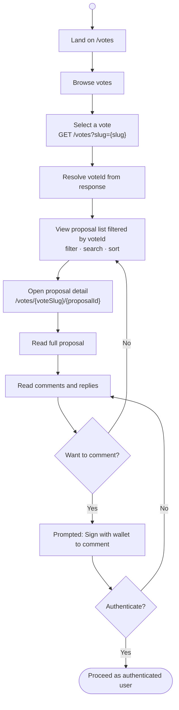
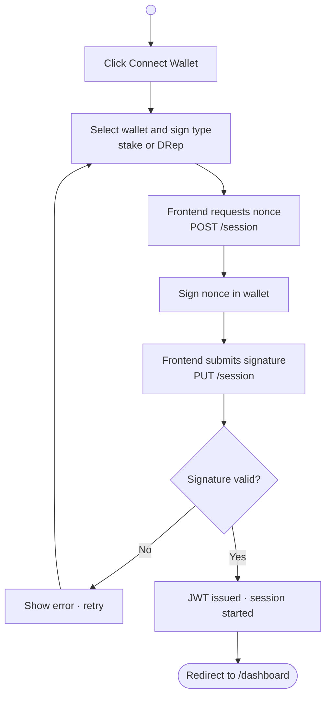
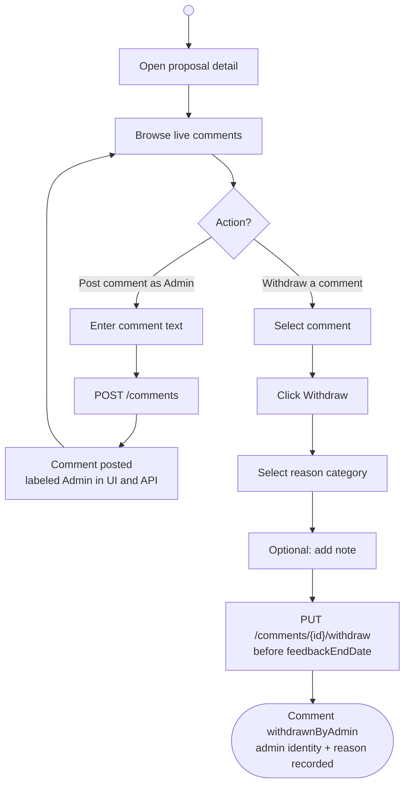

# Ekklesia Proposal Module — User Flows

---

| Field              | Detail                                                                            |
|--------------------|-----------------------------------------------------------------------------------|
| **Document Title** | User Flows                                                                        |
| **Version**        | 0.1.3                                                                             |
| **Created**        | February 19, 2026                                                                 |
| **Last Revised**   | July 23, 2026                                                                 |
| **Companion Doc**  | [System Architecture](system-architecture.md) · [Proposal Flow](proposal-flow.md) |
| **Prepared By**    | Adam Dean · <adam@crypto2099.io>, Mad Orkestra · <mad@madorkestra.com>            |
| **Status**         | Draft                                                                             |

---

## Table of Contents

- [1. Overview](#1-overview)
- [2. Public Viewer](#2-public-viewer)
- [3. Proposer](#3-proposer)
- [4. DRep / Authenticated User](#4-drep--authenticated-user)
- [5. Admin](#5-admin)
- [Revision History](#revision-history)

---

## 1. Overview

This document describes the high-level user flows for the Ekklesia Proposal
Module across all four user roles. Each flow covers the primary journeys a user
of that role will take through the platform. Authentication is wallet-based
throughout (CIP-30 or CLI); the sign-in flow is shared across all authenticated
roles and shown once in §3.

**Roles covered:**

| Role                          | Authentication              | Primary purpose                                |
|-------------------------------|-----------------------------|------------------------------------------------|
| **Public Viewer**             | None                        | Browse and read live proposals                 |
| **Proposer**                  | Wallet (stake or DRep)      | Create, manage, and submit proposals           |
| **DRep / Authenticated User** | Wallet (stake or DRep)      | Browse proposals and participate in discussion |
| **Admin**                     | Wallet (registered address) | Moderate proposals and comments                |

---

## 2. Public Viewer

A public viewer arrives at the platform without authenticating. They can browse
votes, filter and search proposals, read proposal details, and read comments.
They cannot comment or interact with proposals.



---

## 3. Proposer

### 3.1 Authentication (shared across all authenticated roles)



### 3.2 Create and submit a proposal

```mermaid
flowchart TD
    START(( )) --> A[/dashboard — view own proposals]
    A --> B[Click Create Proposal<br />select vote]
    B --> C["/dashboard/{voteSlug}/new — fill structured form"]
    C --> D{Save or Submit?}

    D -->|Save Draft| E["POST /proposals<br />status: draft · partial validation"]
    E --> F[Draft saved · continue editing]
    F --> C

    D -->|Submit| G[Client-side full validation<br />Zod schema]
    G --> H{Valid?}
    H -->|No| I[Show field errors]
    I --> C
    H -->|Yes| J[Confirm legal declarations<br />4 checkboxes required]
    J --> K["PUT /proposals/{id}<br />status: live"]
    K --> L{Within submission window?}
    L -->|No| M[Error: outside submission window]
    M --> C
    L -->|Yes| N([Proposal live · publicly visible])
```

### 3.3 Manage an existing proposal

```mermaid
flowchart TD
    START(( )) --> A[/dashboard — view own proposals]
    A --> B{Select action}

    B -->|Edit draft| C["/dashboard/{voteSlug}/{proposalId}"]
    C --> D[Save changes<br />no full validation]
    D --> A

    B -->|Delete draft| E[Confirm deletion]
    E --> F["DELETE /proposals/{id}"]
    F --> A

    B -->|Edit live proposal| G["/dashboard/{voteSlug}/{proposalId}"]
    G --> H[Save changes<br />full validation · previous version archived]
    H --> A

    B -->|Withdraw live proposal| I[Confirm withdrawal<br />before reviewEndDate]
    I --> J["PUT /proposals/{id}/withdraw<br />category + comment"]
    J --> K([Proposal withdrawnByProposer<br />permanent locked record])
```

---

## 4. DRep / Authenticated User

DReps and other authenticated users share the same browsing journey as public
viewers but gain the ability to comment and interact with proposals after
signing in.

```mermaid
flowchart TD
    START(( )) --> A[Sign in with wallet<br />see §3.1]
    A --> B[/votes — browse votes]
    B --> C["Select vote<br />GET /votes?slug={slug}"]
    C --> D[Resolve voteId from response]
    D --> E["View proposals filtered by voteId<br />filter · search · sort"]
    E --> F["Open proposal detail<br />/votes/{voteSlug}/{proposalId}"]
    F --> G{Action?}

    G -->|Read only| E

    G -->|Post comment| H[Enter comment text]
    H --> I["POST /comments<br />proposalId + content"]
    I --> J[Comment posted · attributed to wallet address]
    J --> F

    G -->|Reply to comment| K[Enter reply text]
    K --> L["POST /comments<br />parentId + content"]
    L --> J

    G -->|Edit own comment| M[Edit within 15 minutes of posting]
    M --> N["PUT /comments/{id}"]
    N --> F

    G -->|Like a comment| O["POST /comments/{id}/like"]
    O --> F
```

---

## 5. Admin

Admins authenticate with a registered wallet address and gain moderation
capabilities scoped to the votes they administer. Admin status is determined
server-side by the presence of the authenticated address in the vote's `admins`
array.

### 5.1 View and moderate proposals

```mermaid
flowchart TD
    START(( )) --> A[Sign in with wallet<br />see §3.1]
    A --> B[/votes — select administered vote]
    B --> C[View all proposals<br />Draft · Live · Withdrawn]
    C --> D{Action?}

    D -->|Read only| C

    D -->|Withdraw a live proposal| E[Select proposal]
    E --> F[Click Withdraw]
    F --> G[Select reason category<br />Inappropriate content · Spam<br />Policy violation · Duplicate submission · Other]
    G --> H[Optional: add note]
    H --> I["PUT /proposals/{id}/withdraw<br />before votingStartDate"]
    I --> J([Proposal withdrawnByAdmin<br />admin identity + reason recorded])
```

### 5.2 Moderate comments



---

## Revision History

This document follows [Semantic Versioning 2.0.0](https://semver.org/). Version
numbers use the form **MAJOR.MINOR.PATCH**:

- **MAJOR** — Incompatible flow changes (e.g. removed journeys, changed role
  definitions).
- **MINOR** — Backwards-compatible additions (e.g. new flows, new decision
  points).
- **PATCH** — Backwards-compatible fixes and clarifications (e.g. typo
  corrections, label updates).

| Version | Date       | Description                                                                                                                                                          |
|---------|------------|----------------------------------------------------------------------------------------------------------------------------------------------------------------------|
| 0.1.3   | 2026-07-23 | Align frontend routes with SvelteKit paths under `/votes/{voteSlug}/…` and `/dashboard/{voteSlug}/…`; withdraw windows. |
| 0.1.2   | 2026-02-19 | All Mermaid \n newlines replaced with br tags; colon-containing labels quoted; slug lookup corrected to GET /votes?slug={slug} with explicit voteId resolution step. |
| 0.1.1   | 2026-02-19 | Terminology update: "Ekklesia Budget Module" → "Ekklesia Proposal Module"; "budget cycle" → "vote"; `/budgets` → `/votes`; `budget.admins` → `vote.admins`.          |
| 0.1.0   | 2026-02-19 | Initial user flow document: public viewer, proposer (auth, create/submit, manage), DRep/authenticated user, and admin (proposals, comments) flows.                   |